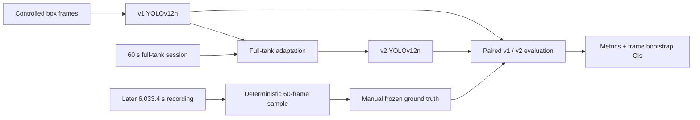
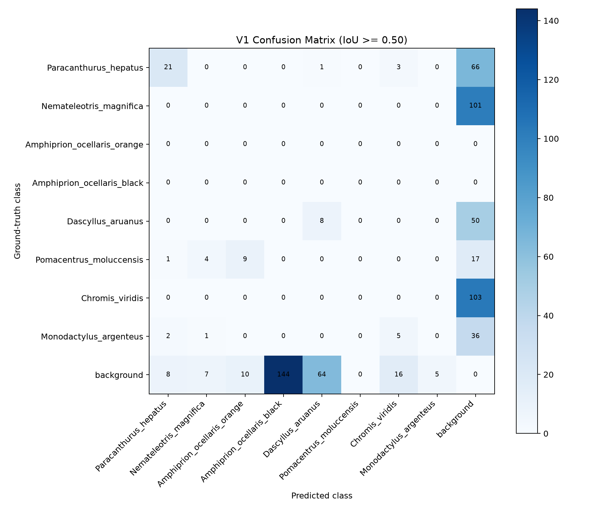
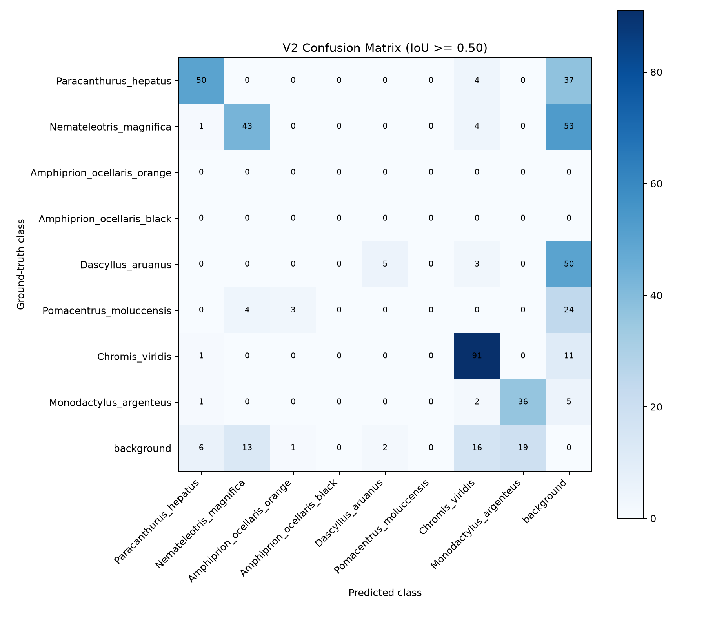

# Reef AI: Aquarium Fish Detection and Tracking

**YOLOv12 fish detection for a fixed full-tank aquarium view, with an independent 60-frame evaluation and paired uncertainty analysis.**

This repository presents a research prototype developed for a reef-aquarium monitoring project. It includes a trained full-tank model, offline video scripts, aggregate evaluation results, figures, and documentation of how the test set was sampled and protected. The complete video and image datasets are not distributed.

> Research prototype. The reported test measures performance on one aquarium installation and one later recording. It does not establish performance in other tanks, camera systems, or wild reef environments.

## At a glance

- Detector: YOLOv12n, adapted from the controlled-tank model to a full-tank view.
- Classes: eight fish categories; the final manuscript name for class 7 is *Monodactylus argenteus* (Silver moony).
- Final test: 60 manually annotated frames, sampled at near-uniform intervals across a separate 6,033.4-second recording; 428 ground-truth boxes.
- Headline comparison: v1 and v2 used the same frozen images, labels, and evaluation settings.
- Test images, labels, per-frame evaluation records, and raw predictions are withheld.

## Pipeline



## Final independent test results

Thresholded detection metrics use confidence `0.35`, class-aware one-to-one matching, and IoU `0.50`. AP uses saved predictions down to confidence `0.001` and 101-point interpolated precision-recall curves. mAP includes the six classes with positive ground truth: IDs `0, 1, 4, 5, 6, 7`. Classes 2 and 3 had no ground-truth examples and are excluded from mAP; their detections still count as false positives for thresholded metrics.

| Model | Precision | Recall | F1 | mAP@50 | mAP@50:95 |
|---|---:|---:|---:|---:|---:|
| v1 controlled | 0.0939 | 0.0678 | 0.0787 | 0.0733 | 0.0430 |
| v2 full-tank adapted | **0.7410** | **0.5280** | **0.6166** | **0.5820** | **0.3034** |

Exact aggregate and per-class tables are in [`results/`](results/). The evaluated v2 checkpoint is included in [`weights/`](weights/).

### Paired frame bootstrap uncertainty

95% percentile intervals were estimated with 10,000 paired frame-level bootstrap replicates, seed `20260918`. Each replicate samples 60 frame IDs with replacement and uses the same sampled IDs and multiplicities for both models. The corrected AP implementation re-expands every sampled occurrence before globally ranking predictions. No fixed target class had zero ground truth in any replicate.

| Metric | v1 point estimate (95% CI) | v2 point estimate (95% CI) | Paired difference v2−v1 (95% CI) |
|---|---:|---:|---:|
| Precision | 0.0939 (0.0685–0.1188) | 0.7410 (0.6896–0.7900) | 0.6471 (0.5958–0.6980) |
| Recall | 0.0678 (0.0494–0.0860) | 0.5280 (0.4847–0.5711) | 0.4603 (0.4200–0.5025) |
| F1 | 0.0787 (0.0576–0.0993) | 0.6166 (0.5751–0.6560) | 0.5379 (0.4986–0.5766) |
| mAP@50 | 0.0733 (0.0576–0.1045) | 0.5820 (0.5375–0.6413) | 0.5087 (0.4621–0.5611) |
| mAP@50:95 | 0.0430 (0.0328–0.0633) | 0.3034 (0.2844–0.3358) | 0.2605 (0.2385–0.2894) |

False positives: v1 `280`, v2 `79`, absolute reduction `201` (`71.79%`; paired bootstrap 95% CI `64.94%–77.97%`). The complete bootstrap table and method are in [`results/paired_bootstrap_95ci_summary.md`](results/paired_bootstrap_95ci_summary.md).

### Confusion matrices

| v1 | v2 |
|---|---|
|  |  |

Training-run curves and each run's development-validation confusion matrices are also included under [`results/development_validation/`](results/development_validation/). They describe training diagnostics; the frozen 60-frame test results above are reported separately.

## Evaluation design and interpretation

### Model development

1. **v1 controlled model:** 419 frames were extracted every two seconds from one controlled-box recording. A deterministic shuffled image-level split used seed 42 on the first 346 manually reviewed frames (276 train, 70 validation). The 73 later auto-labeled frames were assigned to training only. Therefore the final on-disk split is 349 train / 70 validation. Since frames from the same recording and adjacent times occur across the split, v1 validation is same-recording development validation and has temporal-neighbor leakage risk.
2. **v2 full-tank adaptation:** initialized from v1 and fine-tuned using all 419 controlled-origin training/validation images as training data plus 48 manually labeled full-tank frames for training. Twelve frames from the same 60-second adaptation recording formed the v2 development-validation split.
3. **Final test:** a later, separate full-tank recording dated 2026-08-22. The 60 timestamps were fixed from video duration before frame extraction and without model predictions. Manual labels were audited and frozen before inference. SHA-256 comparison found no image overlap with either training dataset, and both checkpoints predate the final recording.

The final test is **new footage from the same deployment domain**. It uses the same aquarium installation and a materially similar frontal `Camera2` view, while some tank equipment/configuration and observed annotated class frequencies differ. It is not an external-aquarium or wild-reef test.

### Metric definitions and fixed settings

- TP: same-class prediction assigned to one ground-truth box at IoU ≥ 0.50.
- FP: unmatched, duplicate, or wrong-class prediction at confidence ≥ 0.35.
- FN: ground-truth box without a matched prediction.
- Precision = TP / (TP + FP); Recall = TP / (TP + FN); F1 is their harmonic mean.
- AP uses confidence-ranked detections at the predeclared `0.001` floor and 101-point interpolation.
- mAP@50:95 averages AP over IoU thresholds 0.50 through 0.95 in 0.05 increments.
- Confidence intervals resample whole frames, not individual boxes. Paired model differences are computed within each replicate.

## Run the included scripts

### Environment

Python 3.10 or newer is recommended. Install runtime packages:

```bash
python -m venv .venv
# Windows PowerShell: .venv\Scripts\Activate.ps1
# macOS/Linux: source .venv/bin/activate
python -m pip install -r requirements.txt
```

The scripts require a working Ultralytics YOLOv12 installation and the associated tracker configuration for tracking mode. For tracking, install FFmpeg if your source video needs unsupported codecs or conversion. Chinese labels use a platform font when available and may fall back depending on the script and host system.

### Render an annotated video

```powershell
python scripts\render_demo_video.py --source path\to\input.mp4 --output outputs\reef_ai_demo.mp4 --model weights\reef_ai_yolov12n_v2_full_tank.pt --imgsz 960 --conf 0.35 --track --stats
```

### Analyze tracks from a video

```powershell
python scripts\analyze_tracking_video.py --source path\to\input.mp4 --model weights\reef_ai_yolov12n_v2_full_tank.pt --output_dir outputs\tracking_analysis --imgsz 960 --conf 0.35 --tracker bytetrack.yaml --save_video
```

### Live camera demo

```powershell
python scripts\live_monitor.py --source_type camera --camera 0 --model weights\reef_ai_yolov12n_v2_full_tank.pt --width 1280 --imgsz 640 --conf 0.45 --track --stats
```

For YouTube Live input, provide a URL explicitly with `--source_type youtube --url <stream-url>`; install FFmpeg/ffprobe on `PATH`. A local video can be used with `--source_type video --video path\to\input.mp4`.

For chunk-based delayed playback from a live stream, the optional pipeline captures short, reduced-resolution chunks and plays annotated chunks as soon as processing completes:

```powershell
python scripts\delayed_live_as_ready.py --url <youtube-live-url> --model weights\reef_ai_yolov12n_v2_full_tank.pt --chunk_seconds 10 --capture_width 800 --capture_fps 10 --track --stats
```

Check each script's `--help` for all options. The tracking analysis script exports CSV summaries and figures. Track IDs can fragment or switch; they must not be interpreted as verified unique fish identities or abundance estimates.

## Repository contents

```text
weights/       v1 comparison checkpoint and recommended v2 full-tank model
scripts/       live camera, offline video renderer, tracking analysis, evaluation code
results/       aggregate/per-class metrics, corrected paired bootstrap, confusion matrices
scripts/evaluation/ evaluation and bootstrap source code (data access required to rerun)
configs/       manuscript-facing class list
docs/          model card, dataset card, methodology and species mapping
```

The repository excludes source videos, raw frames, training labels, frozen test images/labels, raw prediction files, per-frame test records, full training runs, and machine-specific manifests. The evaluation and bootstrap source code is included for methodological inspection, but rerunning it requires authorized access to the frozen images, labels, checksums, and saved detection records. Detailed statistical evidence is retained in aggregate form for review.

## Species names

| ID | Manuscript-facing species |
|---:|---|
| 0 | *Paracanthurus hepatus* |
| 1 | *Nemateleotris magnifica* |
| 2 | *Amphiprion ocellaris* (orange morph) |
| 3 | *Amphiprion ocellaris* (black morph) |
| 4 | *Dascyllus aruanus* |
| 5 | *Pomacentrus moluccensis* |
| 6 | *Chromis viridis* |
| 7 | *Monodactylus argenteus* (Silver moony) |

Historical model metadata and legacy labels use `Platax_sp` for numeric class 7. The final species mapping is documented in [`docs/SPECIES_MAPPING.md`](docs/SPECIES_MAPPING.md); the class ID remains 7 for evaluation compatibility.

## Reproducibility files

- [`results/independent_test_summary.md`](results/independent_test_summary.md): settings, aggregate results, per-class results, and limitations.
- [`results/paired_bootstrap_95ci_summary.md`](results/paired_bootstrap_95ci_summary.md): paired frame bootstrap method and intervals.
- [`docs/DATASET_CARD.md`](docs/DATASET_CARD.md): source composition, split design, withheld-data policy, and limitations.
- [`docs/EVALUATION_PROTOCOL.md`](docs/EVALUATION_PROTOCOL.md): frozen-test protocol and metric definitions.
- [`docs/PROVENANCE.md`](docs/PROVENANCE.md): source provenance and contamination checks with local paths removed.
- [`docs/TECHNICAL_REPRODUCTION.md`](docs/TECHNICAL_REPRODUCTION.md): inputs required to rerun evaluation and bootstrap code.

## Limitations

- The final test contains 60 frames from one recording in one aquarium setup. Frames are temporally spaced but are not independent recordings.
- Classes 2 and 3 have no positive final-test annotations. Recall and AP for these classes cannot be estimated.
- Class-specific performance is uneven; consult the per-class CSV rather than relying only on aggregate metrics.
- Tracking IDs are algorithmic tracklets and are not individual identity labels.
- The 12-frame v2 development-validation split comes from the adaptation recording and is not an independent test.
- The full data are withheld, so external researchers cannot fully reconstruct evaluation from this repository alone.
- The repository does not yet declare a reuse license. Contact the maintainer for permission before redistributing code, weights, figures, or results.

## Citation

This work is being prepared for a CJSJ manuscript. Citation metadata and the final manuscript citation will be added after publication or preprint release.
